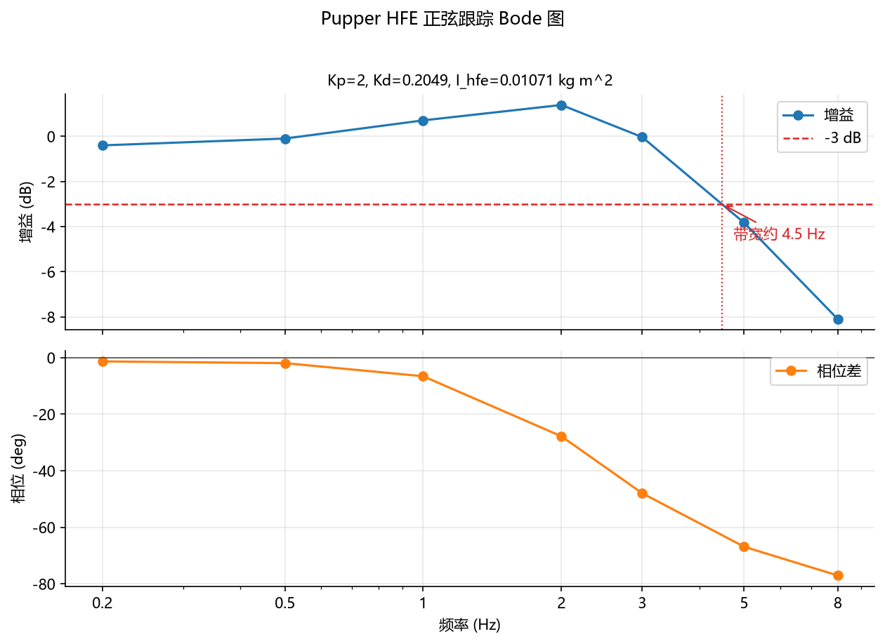
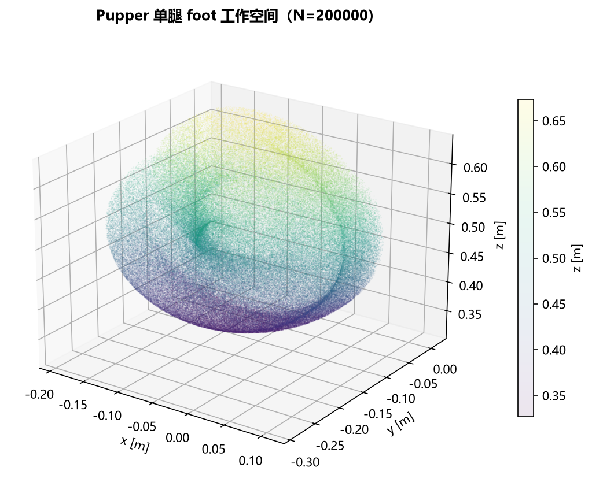
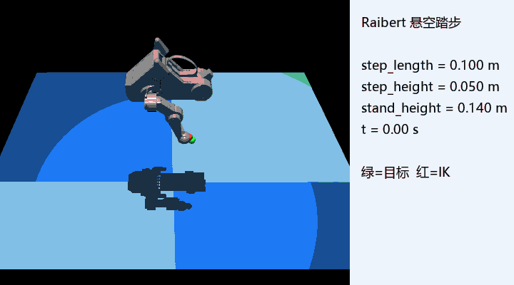

# Quadruped Learning — 从零到一搭建四足机器人

个人学习与实践仓库，基于 Datawhale 开源教程 [《从零到一搭建四足机器人》](https://datawhalechina.github.io/dive-into-embodied-ai/docs/practices/quadruped/cs123/)（Stanford CS123 Pupper v3 体系），在 **Windows + MuJoCo** 环境下从单关节 PD 控制一路做到四足强化学习步态策略训练。

> **写作原则**：本仓库只记录实际跑通并核对过的结果，对实验边界（例如开环步态依赖机身 weld、524k 步基础 PPO 尚不能稳定跟踪速度）如实标注。

---

## 学习进度总览

| 章节 | 主题 | 正文实践 | 正式 Lab | 当前状态 | 核心产物 |
| --- | --- | --- | --- | --- | --- |
| **第 1 章** | 执行器与 PD 控制 | 单关节 PD、正弦跟踪、增益对照 | `lab_1_pid_bode` | ✅ 已完成 | 正弦跟踪 GIF、Bode 频响图、Kp 对比图 |
| **第 2 章** | 正运动学（FK） | 平面 3-DoF FK、工作空间采样 | `lab_2_fk_teleop` | ✅ 已完成 | 单腿遥操作 GIF、3D 工作空间图 |
| **第 3 章** | 逆运动学（IK）与轨迹 | 解析 IK、数值 IK、雅可比与 DLS | `lab_3_stepping` | ✅ 已完成 | 悬空踏步 GIF、步长扫描 GIF、轨迹对比图 |
| **第 4 章** | 搭建四足机器人（MJCF） | 固定/浮动基座站立、三形态对照 | — | ✅ 已完成 | `pupper_v3.xml` + 13 个 STL、站高曲线、增益热图 |
| **第 5 章** | 步态控制 | 开环 walk / trot / pace / bound / gallop | — | ✅ 已完成 | 真实 Pupper 数值 IK + 步态时钟演示 |
| **第 6 章** | 强化学习策略训练（PPO） | 基础 45 维 PPO（524k 步 CPU 训练与评估） | `lab_6_rl_pupper` | 🚧 进行中 | Lab 6 已完成 TODO 2（540 维观测），待完成 TODO 1（18 项奖励）与 TODO 3（命令采样） |

---

## 阶段成果一览

### 第 1 章 · 执行器、PD 控制与频响分析（Lab 1）

- **实践内容**：手写单关节 PD 控制器，对比阻尼增益 $K_d$ 与外力扰动响应；在 `lab_1_pid_bode` 中读取 Pupper 髋俯仰关节（HFE）等效惯量，选取阻尼增益并扫频绘制 Bode 图。
- **关键结论**：幅值接近目标并不等于完美跟踪。在 3 Hz 正弦激励下，实测幅值比仍达 `0.997`，但相位已经滞后 `47.93°`。

<table>
  <tr>
    <td align="center"><br/><sub>HFE 0.3 Hz 正弦跟踪</sub></td>
    <td align="center"><br/><sub>Pupper HFE 频率响应（Bode 图）</sub></td>
  </tr>
</table>

---

### 第 2 章 · 正运动学与单腿工作空间（Lab 2）

- **实践内容**：实现平面三关节与真实 Pupper 单腿的坐标变换链（固定安装变换 × 局部关节旋转），用 MuJoCo 仿真足端位置交叉验证，并故意写错转轴方向观察红球与真实足端分离的现象。
- **关键结论**：自写 FK 与 MuJoCo 内部足端位置误差达到浮点精度量级；关节局部旋转轴写错会立即导致空间轨迹失真。

<table>
  <tr>
    <td align="center"><br/><sub>单腿遥操作与 FK 校验</sub></td>
    <td align="center"><br/><sub>单腿足端工作空间采样</sub></td>
  </tr>
</table>

---

### 第 3 章 · 逆运动学、DLS 与单腿踏步（Lab 3）

- **实践内容**：完成平面解析 IK 与基于雅可比矩阵的阻尼最小二乘（DLS）数值 IK；在 `lab_3_stepping` 中串联 Raibert 足端轨迹、三维 DLS 求解与 PD 关节力矩写入，通过全部 4 项官方检查。
- **关键结论与边界**：
  - 区分整周期时间与支撑/摆动段内进度，导出对照时释放髋部 weld 后真实腿表现出抬腿回摆。
  - 轨迹最前端出现约 `15 mm` 峰值 IK 残差，已定位为目标点超出单腿物理工作空间边界。

<table>
  <tr>
    <td align="center"><br/><sub>单腿悬空踏步（Raibert + 3D DLS）</sub></td>
    <td align="center"><br/><sub>Raibert 轨迹 vs 三角轨迹对比</sub></td>
  </tr>
</table>

---

### 第 4 章 · 搭建四足机器人与形态对比

- **实践内容**：组装并对比固定基座（`pupper_v3_fixed.xml`）与浮动基座（`pupper_v3.xml`）整机模型，验证浮动基座自由落体站立与 PD 刚度热图，对比 `original`、`long-leg`、`heavy` 三种形态的站立稳定性。
- **公共资产**：本章 `chapter04_quadruped_mjcf/assets/mjcfs/` 下的整机 MJCF 与 13 个 STL 网格直接被第 5、6 章复用。

<table>
  <tr>
    <td align="center"><br/><sub>original / long-leg / heavy 三种形态对照</sub></td>
    <td align="center"><br/><sub>不同形态的浮动基座站立高度曲线</sub></td>
  </tr>
</table>

---

### 第 5 章 · 开环步态控制

- **实践内容**：在真实 Pupper v3 网格模型上运行原地 `trot` 及前进 `walk / trot / pace / bound / gallop`，跑通「步态相位时钟 → 足端摆线轨迹 → MuJoCo 数值 IK → 位置伺服」完整链路。
- **实验边界**：演示通过 `MjSpec` 机身 weld 固定/平移机身，用于验证腿部相位与时序协同；**自由基座下的自主推进与动态平衡不在本章验收，转入第 6 章 RL 解决**。

---

### 第 6 章 · 强化学习步态策略训练（进行中）

#### 1. 正文基础版 PPO（已完成首轮 CPU 实测）
- **配置与训练**：45 维观测、12 维位置残差动作、50 Hz 控制 / 250 Hz 物理。本机 CPU（8 并行环境、`seed=0`）从零训练 **524,288 步**，耗时 **162.32 s**。
- **训练趋势**：平均回合长度由 **218 步**提升至 **576 步**，平均回合回报由 **1.87** 升至 **8.18**。
- **独立评估（`seed=42`，确定性策略）**：
  - 12 秒多段指令切换测试中 **0 次跌倒**，机身稳定站立；
  - 给定前向速度指令 `0.2 / 0.4 / 0.6 m/s` 时，实测平均前向速度为 `0.0051 / 0.0060 / 0.0070 m/s`；指令 `0.5 m/s` 段实测 `0.0169 m/s`。
  - **结论**：524k 步已学会“站稳不摔”，但距离稳定迈步和速度跟踪还需要显著更多训练步数（对应正式 Lab 6）。

#### 2. 正式 Lab 6（`lab_6_rl_pupper`，进行中）
- 入口文件：`chapter06_policy_training/lab6/lab_6_rl_pupper/envs/pupper_env.py`（与 MJX/Brax 配方对齐：540 维 15 帧堆叠观测、12 维动作、18 项奖励）。
- 当前进度：
  - [x] **TODO 2 `_get_obs()`**：36 维单帧 + 观测噪声 + IMU 延迟 + 15 帧历史堆叠，已通过单项检查
  - [ ] **TODO 1 `_compute_reward()`**：18 项加权奖励
  - [ ] **TODO 3 `_sample_command()`**：宽范围速度指令采样与近零分支
  - [ ] 全部 4 项官方测试 (`tests.py`)、端到端 PPO 训练、变速评估与 `portfolio/` 交付物

---

## 目录结构

```text
quadruped-learning/
├── README.md
├── .gitignore
├── chapter01_pd_control/          # 第 1 章：单关节 PD、正弦跟踪与 Lab 1 (Bode 频响)
│   └── lab_1_pid_bode/portfolio/
├── chapter02_forward_kinematics/  # 第 2 章：平面/单腿 FK 与 Lab 2 (遥操作 + 工作空间)
│   └── lab_2_fk_teleop/portfolio/
├── chapter03_inverse_kinematics/  # 第 3 章：解析/数值 IK、DLS 与 Lab 3 (单腿踏步)
│   └── lab_3_stepping/portfolio/
├── chapter04_quadruped_mjcf/      # 第 4 章：Pupper v3 整机模型、站立与形态对照
│   ├── 4.quadruped-mjcf/
│   └── assets/mjcfs/              # 公共整机 MJCF 与 13 个 STL 网格（第 5/6 章复用）
├── chapter05_gait_control/        # 第 5 章：真实 Pupper 开环步态控制 demo
└── chapter06_policy_training/     # 第 6 章：正文 PPO 与正式 Lab 6
    ├── configs/                   # 正文训练 YAML 配置
    ├── lab6/                      # 正式 Lab 6（学生编辑 lab_6_rl_pupper/envs/pupper_env.py）
    ├── outputs/                   # (gitignored) 本机训练 checkpoint、评估动画与日志
    └── reports/                   # (gitignored) 上游作者 20M 步对照报告（仅本地保留）
```

---

## 本机环境与常用命令（Windows PowerShell）

本机采用两套独立的 Python 环境：

| 适用章节 | 解释器路径 | 主要依赖 |
| --- | --- | --- |
| **第 1–5 章** | `D:\Miniconda3\envs\mujoco\python.exe` | MuJoCo、NumPy、Matplotlib、Pillow |
| **第 6 章 & Lab 6** | `D:\learn\quadruped-learning\chapter06_policy_training\.venv\Scripts\python.exe` | Python 3.12.16、MuJoCo 3.7.0、Gymnasium 1.2.2、SB3 2.9.2、PyTorch 2.9.1+cpu |

```powershell
# 运行第 5 章步态演示（示例：原地 trot）
& D:\Miniconda3\envs\mujoco\python.exe .\chapter05_gait_control\run_gait_control.py --gait trot --viewer inplace

# 运行第 6 章正文环境自检
Set-Location D:\learn\quadruped-learning\chapter06_policy_training
& .\.venv\Scripts\python.exe .\pupper_env.py

# 运行正式 Lab 6 四项数值断言测试
& .\.venv\Scripts\python.exe -X utf8 .\lab6\lab_6_rl_pupper\tests.py
```
