# Quadruped Learning — 从零到一搭建四足机器人

个人学习与实践仓库，基于 Datawhale 开源教程 [《从零到一搭建四足机器人》](https://datawhalechina.github.io/dive-into-embodied-ai/docs/practices/quadruped/cs123/)（Stanford CS123 Pupper v3 体系），在 **Windows + MuJoCo** 环境下从单关节 PD 控制一路做到四足强化学习步态策略训练与大语言模型具身控制。

> **写作原则**：本仓库只记录实际跑通并核对过的结果，对实验边界（例如开环步态依赖机身 weld、524k 步基础 PPO 尚不能稳定跟踪速度）如实标注。

---

## 学习进度总览

| 章节 | 主题 | 正文实践 | 正式 Lab | 当前状态 | 核心产物 |
| --- | --- | --- | --- | --- | --- |
| **第 1 章** | 执行器与 PD 控制 | 单关节 PD、正弦跟踪、增益对照 | `lab_1_pid_bode` | ✅ 已完成 | 正弦跟踪 GIF、Bode 频响图、Kp 对比图 |
| **第 2 章** | 正运动学（FK） | 平面 3-DoF FK、工作空间采样 | `lab_2_fk_teleop` | ✅ 已完成 | 单腿遥操作 GIF、3D 工作空间图 |
| **第 3 章** | 逆运动学（IK）与轨迹 | 解析 IK、数值 IK、雅可比与 DLS | `lab_3_stepping` | ✅ 已完成 | 悬空踏步 GIF、步长扫描 GIF、轨迹对比图 |
| **第 4 章** | 搭建四足机器人（MJCF） | 固定/浮动基座站立、三形态对照 | — | ✅ 已完成 | `pupper_v3.xml` + 13 个 STL、站高曲线、增益热图 |
| **第 5 章** | 步态控制 | 开环 walk / trot / pace / bound / gallop | — | ✅ 已完成 | 真实 Pupper 数值 IK + 步态时钟演示 |
| **第 6 章** | 强化学习策略训练（PPO） | 45 维 20M 步 CPU PPO（18M 峰值实测 3 档跟速 0 跌倒） | `lab_6_rl_pupper` | ✅ 已完成 | 18M 走路演示 GIF、速度跟踪曲线、Lab 6 540 维环境/4 项测试/150M 对照与反思 |
| **第 7 章** | 语言控制与具身 Agent | 工具 API、OpenAI SDK 原生 ReAct 循环、实时 3D REPL | `lab_7_llm_control` | ✅ 已完成 | L1–L5 任务展柜 GIF、`agent_traces.md`、三段式工具契约与 PI 航向保持消融实验 |

---

## 阶段成果一览

### 第 1 章 · 执行器、PD 控制与频响分析（Lab 1）

- **实践内容**：手写单关节 PD 控制器，对比阻尼增益 $K_d$ 与外力扰动响应；在 `lab_1_pid_bode` 中读取 Pupper 髋俯仰关节（HFE）等效惯量，选取阻尼增益并扫频绘制 Bode 图。
- **关键结论**：幅值接近目标并不等于完美跟踪。在 3 Hz 正弦激励下，实测幅值比仍达 `0.997`，但相位已经滞后 `47.93°`。

<table>
  <tr>
    <td align="center">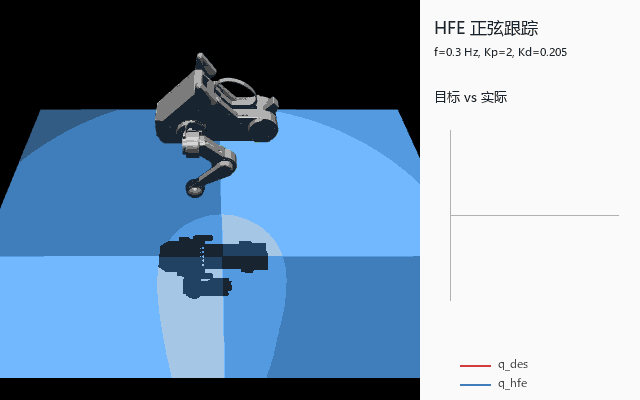<br/><sub>HFE 0.3 Hz 正弦跟踪</sub></td>
    <td align="center"><br/><sub>Pupper HFE 频率响应（Bode 图）</sub></td>
  </tr>
</table>

---

### 第 2 章 · 正运动学与单腿工作空间（Lab 2）

- **实践内容**：实现平面三关节与真实 Pupper 单腿的坐标变换链（固定安装变换 × 局部关节旋转），用 MuJoCo 仿真足端位置交叉验证，并故意写错转轴方向观察红球与真实足端分离的现象。
- **关键结论**：自写 FK 与 MuJoCo 内部足端位置误差达到浮点精度量级；关节局部旋转轴写错会立即导致空间轨迹失真。

<table>
  <tr>
    <td align="center">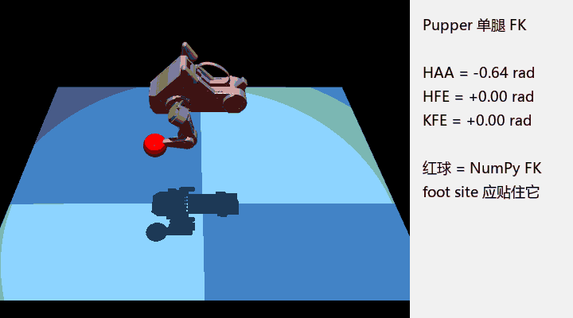<br/><sub>单腿遥操作与 FK 校验</sub></td>
    <td align="center"><br/><sub>单腿足端工作空间采样</sub></td>
  </tr>
</table>

---

### 第 3 章 · 逆运动学、DLS 与单腿踏步（Lab 3）

- **实践内容**：完成平面解析 IK 与基于雅可比矩阵的阻尼最小二乘（DLS）数值 IK；在 `lab_3_stepping` 中串联 Raibert 足端轨迹、三维 DLS 求解与 PD 关节力矩写入，通过全部 4 项官方检查。
- **关键结论与边界**：
  - 区分整周期时间与支撑/摆动段内进度，导出对照时释放髋部 weld 后真实腿表现出抬腿回摆。
  - 轨迹最前端出现约 `15 mm` 峰值 IK 残差，已定位为目标点超出单腿物理工作空间边界。

<table>
  <tr>
    <td align="center"><br/><sub>单腿悬空踏步（Raibert + 3D DLS）</sub></td>
    <td align="center">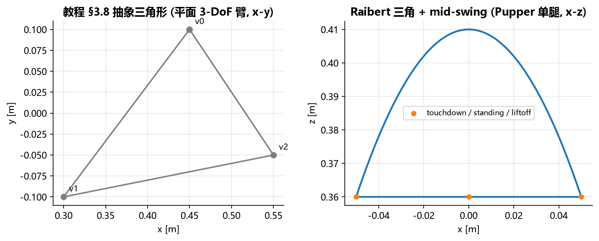<br/><sub>Raibert 轨迹 vs 三角轨迹对比</sub></td>
  </tr>
</table>

---

### 第 4 章 · 搭建四足机器人与形态对比

- **实践内容**：组装并对比固定基座（`pupper_v3_fixed.xml`）与浮动基座（`pupper_v3.xml`）整机模型，验证浮动基座自由落体站立与 PD 刚度热图，对比 `original`、`long-leg`、`heavy` 三种形态的站立稳定性。
- **公共资产**：本章 `chapter04_quadruped_mjcf/assets/mjcfs/` 下的整机 MJCF 与 13 个 STL 网格直接被第 5、6 章复用。

<table>
  <tr>
    <td align="center">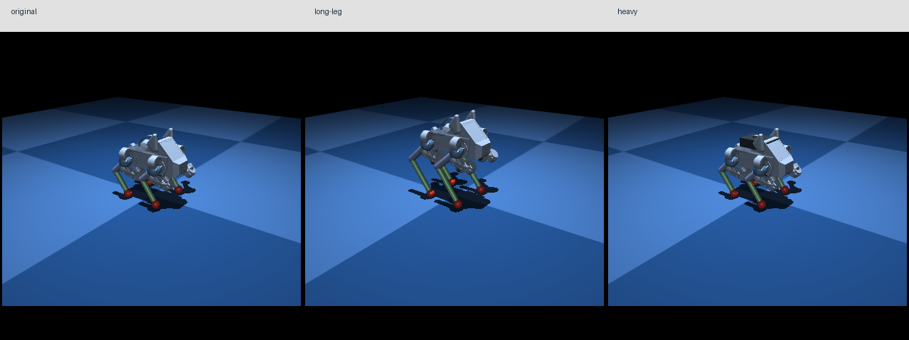<br/><sub>original / long-leg / heavy 三种形态对照</sub></td>
    <td align="center">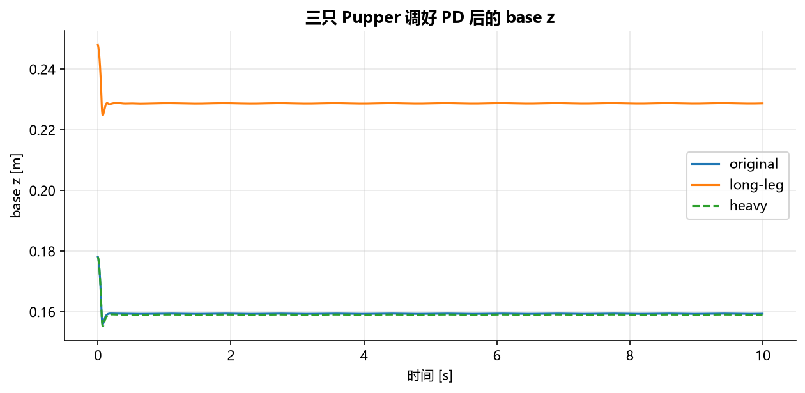<br/><sub>不同形态的浮动基座站立高度曲线</sub></td>
  </tr>
</table>

---

### 第 5 章 · 开环步态控制

- **实践内容**：在真实 Pupper v3 网格模型上运行原地 `trot` 及前进 `walk / trot / pace / bound / gallop`，跑通「步态相位时钟 → 足端摆线轨迹 → MuJoCo 数值 IK → 位置伺服」完整链路。
- **实验边界**：演示通过 `MjSpec` 机身 weld 固定/平移机身，用于验证腿部相位与时序协同；**自由基座下的自主推进与动态平衡不在本章验收，转入第 6 章 RL 解决**。

---

### 第 6 章 · 强化学习步态策略训练（Lab 6）

#### 1. 正文 45 维精简版 PPO（20M 步本机 CPU 实测跑通）
- **配置与训练**：45 维观测、7 项奖励、12 维位置残差动作、`net_arch=[256, 256]`、50 Hz 控制 / 250 Hz 物理。本机 CPU（16 并行环境、`seed=0`）训练 **20,021,248 步**（约 2 小时），平均回合长度由 `253.8` 提升至 `762.1`（峰值 `853.1`），平均回合回报由 `2.50` 升至 `22.89`（峰值 **`25.80` @ 18.4M**）。
- **独立评估（18M 峰值 checkpoint，`seed=42`，确定性策略，去掉首秒热身）**：
  - `vx_cmd = 0.2 / 0.4 / 0.6 m/s` 实测平均前向速度为 **`0.2641 / 0.5180 / 0.5211 m/s`**（三档平均 MAE **`0.0870 m/s`**，全程 **0 次跌倒**），可稳定执行站立、前进、转向与后退变速指令。

<table>
  <tr>
    <td align="center">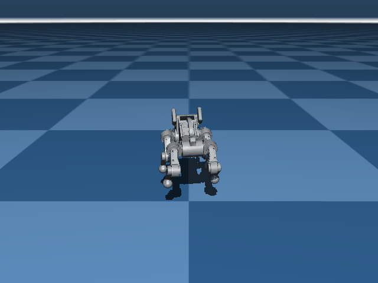<br/><sub>45 维 18M 步 CPU PPO 变速走路演示</sub></td>
    <td align="center">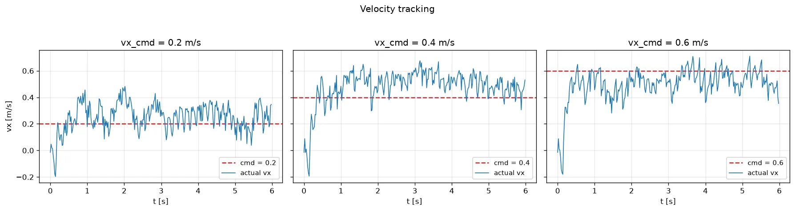<br/><sub>0.2 / 0.4 / 0.6 m/s 三档速度跟踪曲线（MAE 0.087 m/s，0 跌倒）</sub></td>
  </tr>
</table>

#### 2. 正式 Lab 6（`lab_6_rl_pupper`，540 维 18 项配方与消融诊断）
- **代码实现与测试**：在 `chapter06_policy_training/lab6/lab_6_rl_pupper/envs/pupper_env.py` 完成全部 3 个手写 TODO，并通过全部 4 项官方数值断言测试（`tests.py`）：
  - [x] **TODO 1 `_compute_reward()`**：18 项加权奖励（跟踪 3 + 机身稳定 3 + 能耗平滑 4 + 步态静止 4 + 终止碰撞 4）+ `× dt` + `[0, 10000]` 截断
  - [x] **TODO 2 `_get_obs()`**：36 维单帧 + 观测噪声 + IMU 延迟 + 15 帧最新置顶堆叠（540 维）
  - [x] **TODO 3 `_sample_command()`**：宽范围速度指令（`vx ±0.75 / vy ±0.5 / wz ±2.0`）与 1% `±0.1` 近零分支
- **实测对照与实验边界**（完整交付物见 `chapter06_policy_training/lab6/lab_6_rl_pupper/portfolio/`，含 `pupper_ppo.zip`、`rl_pupper_commands.gif`、`comparison.gif`、`reward_curve.png`、`velocity_tracking.png`、`notes.md`）：
  - **原版超参 150M 步本机 CPU 训练（约 21.3 小时）**：`ep_len_mean` 由 `31` 升至 **`980 / 1000`**，`ep_rew_mean` 达 **`28.7`**（110M 峰值 **`31.98`**），膝盖/机身碰撞归零；但实测发现 SB3 默认无界高斯配合 `ent_coef=0.01` 与环境外层 `action.clip(-1, 1)` 会在长训下触发“刷熵饱和”——`std` 膨胀至 **`214`**，10/12 个关节均值被推至 `±1` 饱和锁死，策略落入原地站立局部最优（三档速度跟踪停留在 `0.00 m/s`）。
  - **修复消融（不改 `pupper_env.py`，仅调整 `starter.py`）**：将 `ent_coef` 归零、网络扩容至 `[256, 256]` 并设 `log_std_init=-0.7` 后，8M 步即达到 `ep_len=903`、`ep_rew=26.7`、直腿 0 跌倒站立且彻底消除 `std` 爆炸；进一步引入 `--curriculum` 阶段热启（去 `tracking_orientation` 静态保底奖 + 强化线速度跟踪 + `target_kl=0.02` + `LogStdClampCallback`）后，`r_tracking_lin_vel_mean` 首次由 `0.63` 突破至 `1.00`、`r_feet_air_time_mean` 转正。
  - **硬件边界说明**：在 Colab GPU 实测 `train_brax_ppo.py`（MJX）时，确认 `cuda13` 插件在 Driver 580 A100 上触发核函数挂起，切换 `--backend cuda12` 后在 L4 上可正常运行，但因 `pupper_v3_floating.xml` 采用高精度椭圆摩擦锥（`cone="elliptic" impratio="100"`），L4 显存带宽下稳态仅 `~2,427 steps/s`（低于本机 20 核 CPU）；完整 540 维 18 项配方的大规模并行收敛需高带宽 GPU（A100 `cuda12` 等）支持。

<table>
  <tr>
    <td align="center">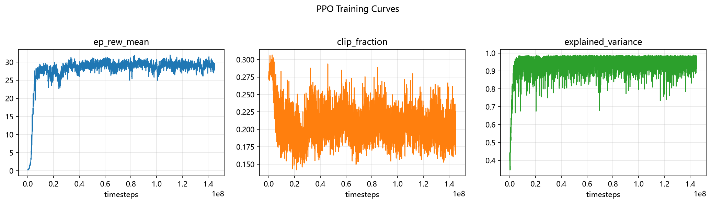<br/><sub>Lab 6 150M 步训练曲线（ep_rew 达 28.7，峰值 31.98）</sub></td>
    <td align="center">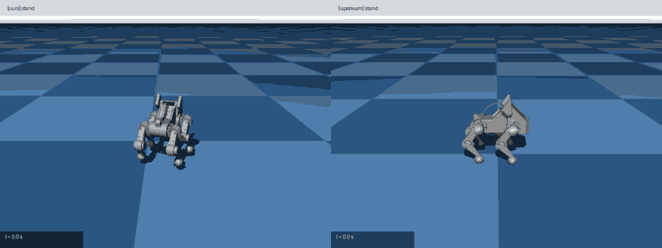<br/><sub>Lab 6 左右对照（左：本机 SB3 vs 右：上游 test_policy.json）</sub></td>
  </tr>
</table>

---

### 第 7 章 · 语言控制与具身 Agent（Lab 7）

- **实践内容**：完成正式 `lab_7_llm_control` 全部 3 个手写 TODO——工具安全分发与软失败（`dispatch()`）、OpenAI-compatible SDK 原生多轮 `tool_calls` 循环（`run_agent()`，对接 DeepSeek `deepseek-chat`）及 12 fps 离屏采帧录屏管线（`render_task_gif()`），通过全部 7 项离线数值断言（`tests.py`）；另外搭建了带 MuJoCo 实时 3D Viewer 与 `Ctrl+C` 急停的交互式文本 REPL（`repl.py`）。
- **L1–L5 标准任务展柜实测**（完整轨迹见 `chapter07_llm_control/lab_7_llm_control/portfolio/agent_traces.md`）：
  - **L1 原子 / L2 带数字**：底层策略存在速度跟踪误差（`walk(0.3, 0, 3.0)` 实测前进 `0.699 m`），但大脑读取 `final_pose` 后自动补走微调，L2 精准停在 `x = 0.986 m`（误差 `1.4 cm`）。
  - **L3 多步顺序**：前进 1 米后经 4 次右转闭环微调，最终 `yaw = -1.578 rad`（距 `-π/2` 误差仅 `0.4°`）。
  - **L4 ReAct 反馈**：自主计算方位角 `atan2(1, 2) ≈ 26.6°`，多轮迭代后停在 `(2.041, 1.071)`（距目标 `(2, 1)` 约 `8 cm`）。
  - **L5 容错降级**：`TOOLS` schema 的量程前置约束使 `deepseek-chat` 主动将 `3 m/s` 降速至上限 `1.5 m/s`；运行时越界与非数字参数软失败由 `tests.py` 验证绝不 `raise`。

<table>
  <tr>
    <td align="center">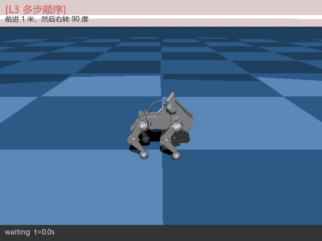<br/><sub>L3 多步顺序：前进 1 m 后右转 90°（最终 yaw = -1.578 rad）</sub></td>
    <td align="center">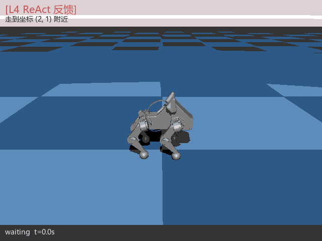<br/><sub>L4 ReAct 闭环导航：抵达 (2.041, 1.071)</sub></td>
  </tr>
</table>

- **拓展消融实验：压力测试 `"最快速度转两圈，然后飞奔向前4m"` 的三段式改进**（在保持 4 个官方工具与 7/7 测试全部通过的前提下，不换模型、不重训 RL，仅迭代中层遥测与控制闭环）：

| 阶段 | 核心改动 | 旋转阶段实测 | 高速直跑（`vx=1.5`）净偏航漂移 | 核心结论与边界 |
| --- | --- | --- | --- | --- |
| **Stage 1 (`before`)** | 原始 4 工具（仅返折叠 `yaw ∈ [-π, π]`） | ~3 圈（5 步，日志出现 `2π*?` 盲猜，起跑偏 `-15.5°`） | 6 s 左偏 **`+0.592 rad`（33.9°）** | 角度折叠混叠导致圈数丢失；终位 `y=-0.058` 实为起跑右偏与底层左偏巧合抵消 |
| **Stage 2 (`after`)** | + 无折叠角度/位移遥测（`delta_turns / total_turns / delta_dist_m`） | **2.000 圈**（2 步，起跑仅偏 `-0.5°`，总调用 8→4） | 6 s 左偏 **`+0.594 rad`（34.0°）** | 彻底根治角度盲区；暴露 `test_policy.json` 高速开环系统性左偏（`~+0.10 rad/s`） |
| **Stage 3 (`v3`)** | + 中层 **PI 航向保持外环（带抗积分饱和）** + 旋转后回正纪律 | 首步同样给 10 s 冲至 `2.242 圈`，凭无折叠遥测立即反向回正至 `yaw = +0.011 rad`（`0.6°`） | **10 s 狂奔 7.07 m 仅偏 `-0.009 rad`（0.5°）**，横向仅偏 `8.8 cm`（漂移降幅 **>98%**） | 先测纯 P（`kp=2.0`）留 `+0.145 rad` 静差，加 I 后几乎零偏；但 LLM 误估 `duration=10` 冲过头到 `7.02 m` 后自主倒车回到 `x=4.072 m`，印证开环时间参数 `duration` 的天然上限 |

<table>
  <tr>
    <td align="center">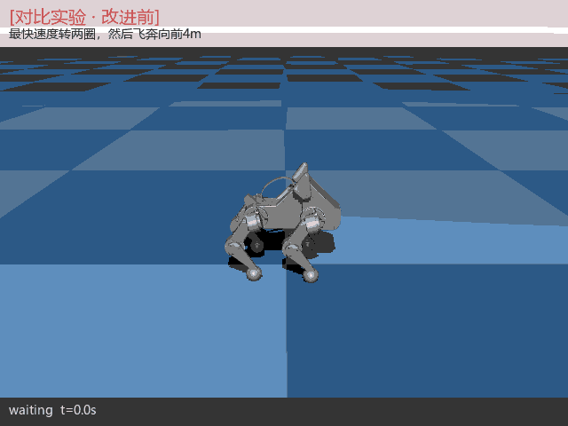<br/><sub>Stage 1：原始基线（角度折叠，多转 1 圈）</sub></td>
    <td align="center">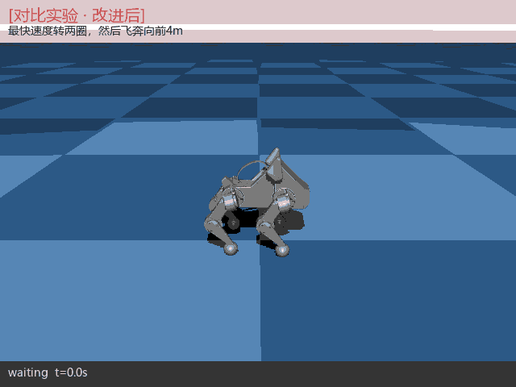<br/><sub>Stage 2：+无折叠遥测（精准 2.00 圈，暴露高速左偏）</sub></td>
    <td align="center">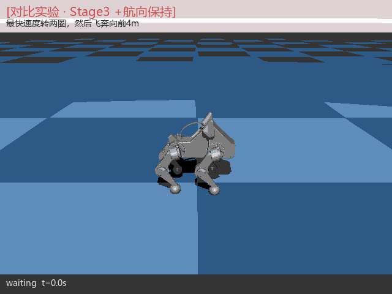<br/><sub>Stage 3：+PI 航向保持（7 m 狂奔仅偏 0.5°）</sub></td>
  </tr>
</table>

- **实验边界**：本章底层策略复用上游 `test_policy.json`（待第 6 章 Lab 6 150M 步自训权重完成后可无缝替换对比）；§7.7.2 Whisper 语音控制作为选做扩展暂未接入。

---

## 目录结构

```text
quadruped-learning/
├── README.md
├── .gitignore
├── chapter01_pd_control/          # 第 1 章：单关节 PD、正弦跟踪与 Lab 1 (Bode 频响)
│   └── lab_1_pid_bode/portfolio/
├── chapter02_forward_kinematics/  # 第 2 章：平面/单腿 FK 与 Lab 2 (遥操作 + 工作空间)
│   └── lab_2_fk_teleop/portfolio/
├── chapter03_inverse_kinematics/  # 第 3 章：解析/数值 IK、DLS 与 Lab 3 (单腿踏步)
│   └── lab_3_stepping/portfolio/
├── chapter04_quadruped_mjcf/      # 第 4 章：Pupper v3 整机模型、站立与形态对照
│   ├── 4.quadruped-mjcf/
│   └── assets/mjcfs/              # 公共整机 MJCF 与 13 个 STL 网格（第 5/6 章复用）
├── chapter05_gait_control/        # 第 5 章：真实 Pupper 开环步态控制 demo
├── chapter06_policy_training/     # 第 6 章：正文 45 维 PPO 与正式 Lab 6
│   ├── configs/                   # 正文训练 YAML 配置
│   ├── portfolio/                 # 正文 45 维 18M 步走路演示 GIF 与三档速度跟踪曲线
│   ├── lab6/                      # 正式 Lab 6（学生编辑 lab_6_rl_pupper/envs/pupper_env.py）
│   │   └── lab_6_rl_pupper/portfolio/  # Lab 6 权重、对比 GIF、训练曲线与反思 notes.md
│   ├── outputs/                   # (gitignored) 本机训练 checkpoint、评估动画与日志
│   └── reports/                   # (gitignored) 上游作者 20M 步对照报告（仅本地保留）
└── chapter07_llm_control/         # 第 7 章：LLM 语言控制、正式 Lab 7 与三段式消融实验
    ├── START_HERE.md              # 本机环境与复用资产说明
    └── lab_7_llm_control/         # dispatch / run_agent / render_task_gif / 实时 3D REPL
        └── portfolio/             # L1–L5 展柜 GIF、agent_traces.md、三段式对照实验与 notes.md
```

---

## 本机环境与常用命令（Windows PowerShell）

本机采用两套独立的 Python 环境：

| 适用章节 | 解释器路径 | 主要依赖 |
| --- | --- | --- |
| **第 1–5 章** | `D:\Miniconda3\envs\mujoco\python.exe` | MuJoCo、NumPy、Matplotlib、Pillow |
| **第 6–7 章 & Lab 6–7** | `D:\learn\quadruped-learning\chapter06_policy_training\.venv\Scripts\python.exe` | Python 3.12.16、MuJoCo 3.7.0、Gymnasium 1.2.2、SB3 2.9.2、PyTorch 2.9.1+cpu、openai、python-dotenv |

```powershell
# 运行第 5 章步态演示（示例：原地 trot）
& D:\Miniconda3\envs\mujoco\python.exe .\chapter05_gait_control\run_gait_control.py --gait trot --viewer inplace

# 运行第 6 章正文环境自检
Set-Location D:\learn\quadruped-learning\chapter06_policy_training
& .\.venv\Scripts\python.exe .\pupper_env.py

# 运行正式 Lab 6 四项数值断言测试
& .\.venv\Scripts\python.exe -X utf8 .\lab6\lab_6_rl_pupper\tests.py

# 运行正式 Lab 7 七项离线数值断言测试（无需 API Key）
Set-Location D:\learn\quadruped-learning\chapter07_llm_control
& ..\chapter06_policy_training\.venv\Scripts\python.exe -X utf8 .\lab_7_llm_control\tests.py

# 启动第 7 章实时 3D 交互式文本 REPL（需在 lab_7_llm_control/.env 配置 API Key）
& ..\chapter06_policy_training\.venv\Scripts\python.exe -X utf8 .\lab_7_llm_control\repl.py
```
